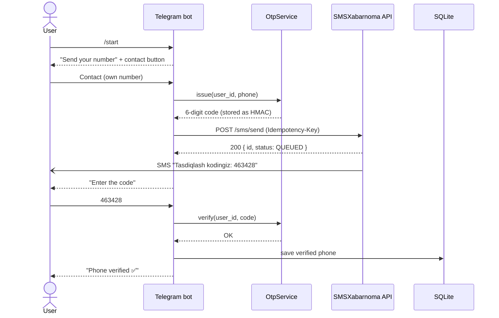

<div align="center">

# 📱 SMS OTP Telegram Bot

**Telegram bot that verifies a user's phone number with a one-time SMS code.**

Built with Python and [aiogram 3](https://docs.aiogram.dev). It sends SMS through [SMSXabarnoma.uz](https://smsxabarnoma.uz) and talks to users in Uzbek and Russian.

[](https://github.com/ismoillooff/sms-otp-telegram-bot/actions/workflows/ci.yml)


[](LICENSE)

[Features](#-features) · [How it works](#-how-it-works) · [Quick start](#-quick-start) · [Configuration](#%EF%B8%8F-configuration) · [Docker](#-docker) · [Troubleshooting](#-troubleshooting) · [O'zbekcha](#-ozbekcha-qisqacha)

</div>

---

## ✨ Features

- **One-tap phone sharing.** `/start` shows a **📱 Send number** button that uses Telegram's `request_contact`.
- **Only the user's own number.** The bot rejects forwarded contacts that belong to someone else. Users can also type the number by hand (`+998 90 123 45 67`, `901234567`, …).
- **Real SMS delivery** through the SMSXabarnoma.uz REST API, plus a free `console` mode for development.
- **Code verification** with **🔄 Resend code** and **✏️ Change number** buttons.
- **Abuse protection:** codes expire, each code allows a limited number of attempts, resends have a cooldown, and each user has an hourly SMS limit.
- **No double charges.** Each SMS carries an `Idempotency-Key`, so a network retry never sends or bills the same SMS twice.
- **Persistent results.** Verified numbers are saved to SQLite.
- **Uzbek and Russian.** The language follows the user's Telegram settings.
- **42 unit tests** and a GitHub Actions CI pipeline on Python 3.11–3.13.
- **Docker image** that runs as a non-root user.

## 💬 Conversation

```text
👤 /start
🤖 Assalomu alaykum, Ali! 👋
   Telefon raqamingizni tasdiqlash uchun pastdagi «📱 Raqamni yuborish» tugmasini bosing.
   [ 📱 Raqamni yuborish ]

👤 (shares contact)
🤖 📨 Raqam qabul qilindi: +998 90 123 45 67
🤖 ✅ +998 90 123 45 67 raqamiga 6 xonali tasdiqlash kodi yuborildi.
   🔢 Yuborilgan kodni kiriting:
   ⏳ Kod 5 daqiqa amal qiladi.
   [ 🔄 Kodni qayta yuborish ]
   [ ✏️ Raqamni o'zgartirish ]

👤 000000
🤖 ❌ Kod noto'g'ri. Qolgan urinishlar: 2

👤 463428
🤖 🎉 Raqamingiz muvaffaqiyatli tasdiqlandi!
   📱 +998 90 123 45 67
```

## 🔄 How it works



The conversation is a two-state FSM: `Verify.phone` and then `Verify.code`.

| State | Accepted input | Result |
|---|---|---|
| `Verify.phone` | contact, or a typed phone number | sends the code and moves to `Verify.code` |
| `Verify.code` | 6-digit code, **Resend**, **Change number** | verifies the code; on success clears the state and saves the number |

## 🚀 Quick start

**Requirements:** Python 3.11+, a bot token from [@BotFather](https://t.me/BotFather), and for real SMS an [SMSXabarnoma.uz](https://smsxabarnoma.uz) API key.

```bash
git clone https://github.com/ismoillooff/sms-otp-telegram-bot.git
cd sms-otp-telegram-bot

python -m venv .venv
# Windows: .venv\Scripts\activate
source .venv/bin/activate

pip install -r requirements.txt
```

Create a `.env` file in the project root:

```dotenv
BOT_TOKEN=123456789:AA...your-token
SMS_PROVIDER=console          # start in console mode: codes go to the terminal
```

Run:

```bash
python bot.py
```

Open the bot in Telegram and press **/start**. In `console` mode the code appears in the terminal:

```text
WARNING | app.sms | [CONSOLE SMS] to +998901234567: Tasdiqlash kodingiz: 463428. Kodni hech kimga bermang.
```

To send real SMS, switch the provider:

```dotenv
SMS_PROVIDER=smsxabarnoma
SMSX_API_KEY=sk_...
```

At startup the bot calls `GET /balance` to check the key and logs the balance, the price per SMS and the key's permissions.

## ⚙️ Configuration

All settings come from environment variables or a `.env` file.

| Variable | Default | Description |
|---|---|---|
| `BOT_TOKEN` | — *(required)* | Telegram bot token from @BotFather |
| `SMS_PROVIDER` | `console` | `console` prints codes to the log; `smsxabarnoma` sends real SMS |
| `SMSX_API_KEY` | — | SMSXabarnoma API key (`sk_...`), needs the `send` scope |
| `SMSX_BASE_URL` | `https://smsxabarnoma.uz/api/v1` | API base URL |
| `SMSX_CALLBACK_URL` | *(empty)* | Optional webhook for delivery-status updates |
| `SMS_TEMPLATE` | `Tasdiqlash kodingiz: {code}. Kodni hech kimga bermang.` | SMS text; must contain `{code}` |
| `OTP_LENGTH` | `6` | Code length (4–8) |
| `OTP_TTL_SECONDS` | `300` | How long a code stays valid |
| `OTP_MAX_ATTEMPTS` | `3` | Wrong attempts allowed before the code is invalidated |
| `OTP_RESEND_COOLDOWN_SECONDS` | `60` | Minimum delay between two SMS for one user |
| `OTP_MAX_SENDS_PER_HOUR` | `5` | SMS limit per user per rolling hour |
| `DB_PATH` | `bot.db` | SQLite file for verified users |

## 📨 SMSXabarnoma.uz setup

1. Sign up at [smsxabarnoma.uz](https://smsxabarnoma.uz) and top up your balance.
2. Go to **API kalitlar** and create a key. Give it the `send` scope; `read` is also needed for the startup balance check.
3. Put the key in `SMSX_API_KEY`. Optionally restrict it to your server's IP address.

Useful facts from the [API docs](https://smsxabarnoma.uz):

- **Pricing:** 120 UZS per SMS part, plus a **monthly API key fee** (20,000 UZS at the time of writing). A Latin-script SMS is 160 characters per part; Cyrillic is 70. The default template is one Latin part.
- **Refunds:** `FAILED` SMS are refunded automatically. `UNDELIVERED` SMS are not refunded.
- **Moderation:** suspicious texts get `PENDING_REVIEW` and may arrive late. Keep `SMS_TEMPLATE` fixed so that only the code changes.
- **Statuses:** `QUEUED` → `ASSIGNED` → `SENT` → `DELIVERED` (or `UNDELIVERED` / `FAILED`).

## 🐳 Docker

```bash
docker build -t sms-otp-bot .
docker run -d --name sms-otp-bot --restart unless-stopped \
  --env-file .env \
  -v sms-otp-data:/data \
  sms-otp-bot
```

The image runs as a non-root user. The SQLite database is stored in the `/data` volume, and `.env` is never copied into the image.

## 🧪 Testing

```bash
pip install pytest
pytest -q
```

The tests cover:
- the OTP lifecycle: correct code, wrong code, lockout, expiry, resend cooldown and the hourly limit;
- phone number normalization;
- uz/ru text parity: both languages have the same keys and the same placeholders.

CI runs the suite on every push and pull request.

## 🗂 Project structure

```text
.
├── bot.py               # Entry point: wiring, startup checks, long polling
├── app/
│   ├── config.py        # Settings from .env with validation
│   ├── handlers.py      # Conversation logic (aiogram Router + FSM)
│   ├── otp.py           # Code generation, TTL, attempts, rate limits
│   ├── sms.py           # ConsoleSmsSender, SmsXabarnomaSender
│   ├── storage.py       # SQLite storage for verified users
│   ├── texts.py         # uz / ru texts
│   ├── keyboards.py     # Contact button and inline buttons
│   ├── phone.py         # +998 number normalization and formatting
│   └── states.py        # FSM states
├── tests/               # pytest suite
├── Dockerfile
└── .github/workflows/ci.yml
```

## 🔐 Security

| Concern | Handling |
|---|---|
| Brute-forcing the code | 3 attempts per code, then the code is invalidated |
| SMS bombing / cost abuse | 60 s resend cooldown and 5 SMS per user per hour, also across number changes |
| Verifying someone else's number | Shared contacts must have `contact.user_id == sender id` |
| Code leakage from memory | Codes are stored as HMAC-SHA256 with a per-process random key and compared in constant time |
| Double charges on retry | Every SMS carries a unique `Idempotency-Key`; retries reuse it |
| Secrets in git or Docker images | `.env` is listed in `.gitignore` and `.dockerignore` |

## 🛠 Troubleshooting

| Symptom | Cause | Fix |
|---|---|---|
| `TelegramConflictError: terminated by other getUpdates request` | Another process is polling with the same token | Stop the other instance, or revoke the token in @BotFather |
| Bot replies "SMS yuborishda xatolik", log shows `402 SUBSCRIPTION_UNPAID` | The API key's monthly fee is unpaid | Top up the balance so the monthly fee can be charged |
| Log shows `402 INSUFFICIENT_BALANCE` | Not enough balance for the SMS | Top up the balance |
| Log shows `403 SCOPE_DENIED` / `IP_NOT_ALLOWED` | The key lacks `send`, or the server's IP is not allowed | Fix the key settings in the SMSXabarnoma cabinet |
| Log shows `429 KEY_DAILY_LIMIT` | The key's daily or monthly limit is used up | Raise the limit with SMSXabarnoma |
| SMS arrives late, log shows `PENDING_REVIEW` | The text is under moderation | Use a plain, fixed template |
| `Config error: BOT_TOKEN is not set` | `.env` is missing | Create `.env` (see [Quick start](#-quick-start)) |

## ⚠️ Limitations

- OTP sessions and FSM state are kept **in memory** and are lost on restart. Verified numbers survive because they are in SQLite. To run several instances, move both to Redis (`RedisStorage` in aiogram).
- Only **Uzbek numbers (`+998`)** are accepted, because the SMS gateway covers Uzbekistan.
- The bot uses long polling. Webhook mode is not implemented.

## 🇺🇿 O'zbekcha qisqacha

Bu bot Telegram foydalanuvchisining telefon raqamini SMS kod orqali tasdiqlaydi:

1. `/start` bosilganda bot raqam so'raydi va pastda **📱 Raqamni yuborish** tugmasi chiqadi.
2. Raqam qabul qilingach, unga 6 xonali kod SMS qilib yuboriladi (SMSXabarnoma.uz orqali).
3. Bot **«Yuborilgan kodni kiriting»** deb so'raydi va kiritilgan kodni tekshiradi.
4. Kod to'g'ri bo'lsa, raqam tasdiqlanadi va bazaga saqlanadi.

**Ishga tushirish:** `pip install -r requirements.txt` buyrug'ini bajaring va `.env` faylini yarating (`BOT_TOKEN`, `SMS_PROVIDER`, `SMSX_API_KEY`). Keyin `python bot.py` bilan ishga tushiring. Sinov uchun `SMS_PROVIDER=console` qo'ying: kod SMS o'rniga terminalga chiqadi va pul sarflanmaydi.

**Muhim:** SMSXabarnoma'da API kalitning oylik to'lovi (20 000 so'm) va har bir SMS uchun 120 so'm yechiladi.

## 📄 License

[MIT](LICENSE) © 2026 Hayotbek Ismoilov
